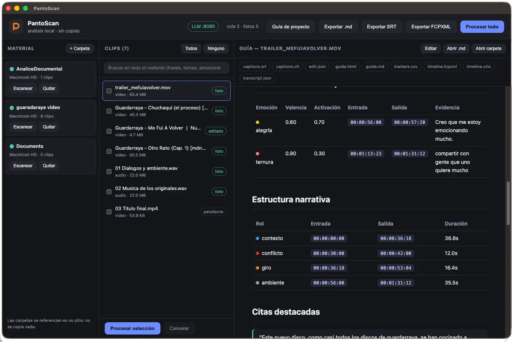

<p align="center">
  
</p>

# PantoScan

Herramienta local (macOS) para **catalogar y analizar material de video en crudo** sin copiarlo: indexa carpetas por referencia, transcribe con tiempos, detecta **temas y emociones en el tiempo** y produce una **guía de edición** exportable (Markdown, subtítulos `.srt`, timelines `.fcpxml`, selectos `.csv`).

Todo el procesamiento es local y privado. El resultado pesa prácticamente nada: solo texto.



## Características

- **Biblioteca por referencia**: mapea carpetas de discos externos por `volumen + ruta relativa` (sin mover ni duplicar material), con revalidación de discos desconectados.
- **Cola de trabajo** por lotes, reencolado de jobs colgados y **cancelación** en cualquier punto.
- **Reuso inteligente**: si el material no cambió (fingerprint) y tampoco el modelo, no repite ASR ni análisis.
- **Transcripción** con [whisper.cpp](https://github.com/ggerganov/whisper.cpp) (timestamps por palabra).
- **Análisis** con un LLM local compatible con OpenAI (LM Studio / `mlx_lm`): 11 temas + 11 emociones (valencia/activación) + roles narrativos.
- **Guía de proyecto**: panorama, índice de temas, mapa de emociones, línea de tiempo por clip y selectos (paper edit).
- **Búsqueda global** (SQLite FTS5) sobre segmentos, temas, emociones y citas.
- **Humano en el loop**: edita resumen/temas/emociones/roles/citas y regenera todas las salidas.
- **Exportaciones** con selector de carpeta: `.md`, `.srt`, `.fcpxml`.

## Requisitos

- **macOS** (usa `app.dock`, volúmenes de disco).
- **Node.js ≥ 22.5** (usa `node:sqlite` con FTS5).
- **ffmpeg** / **ffprobe** y **whisper.cpp** (`whisper-cli`) en el `PATH` o configurados en el `config.json`.
- Un **modelo de whisper** (`ggml-*.bin`).
- Un **servidor LLM** local OpenAI-compatible (por ejemplo LM Studio en `:1234` o `mlx_lm.server` en `:8081`).

## Instalación y desarrollo

```bash
npm install
npm start          # abre la app (Electron)
npm test           # 33 pruebas (node:test)
npm run check      # chequeo sintáctico de los módulos
```

## Configuración

Opcional, en `~/.config/analicedocumental/config.json` (fuera del repo):

```json
{
  "llmEndpoint": "http://127.0.0.1:8081/v1",
  "llmModel": "/ruta/al/modelo-llm",
  "asrModel": "/ruta/al/ggml-model.bin",
  "ffmpegPath": "/opt/homebrew/bin/ffmpeg",
  "whisperPath": "/opt/homebrew/bin/whisper-cli"
}
```

También se pueden usar las variables `DOC_LLM_ENDPOINT`, `DOC_LLM_MODEL`, `DOC_ASR_MODEL`, `DOC_FFMPEG`, `DOC_WHISPER`. El servidor LLM de ejemplo se levanta con `npm run llm`.

## Uso

UI de tres paneles: **Fuentes** (agregar/escanear), **Clips** (encolar/procesar) y **Resultado** (ver, editar, exportar). Arriba: búsqueda global, estado del LLM y de la cola, y botones de exportación.

CLI:

```bash
node src/cli.js scan <carpeta> [--enqueue]
node src/cli.js sources | clips [--source id] | enqueue [--force]
node src/cli.js run [--force] [--out dir]
node src/cli.js status | results
node src/cli.js guide [--out dir]
node src/cli.js search "términos"
```

## Build (app empaquetada)

```bash
npm run build:dir   # genera dist/mac-arm64/PantoScan.app (sin firmar)
npm run build       # genera el .dmg
```

> La app empaquetada depende de `ffmpeg`/`whisper-cli`; si se abre desde Finder, conviene fijar sus rutas absolutas en el `config.json`.

## Estructura

```
src/main/main.js        Electron main + IPC
src/main/lib/           volumes, media, library, queue, store, asr, analysis, taxonomy,
                        edit, guide, project, exports, pipeline, config
src/preload/preload.js  puente IPC seguro (contextIsolation)
src/renderer/           UI (index.html, styles.css, app.js)
src/cli.js              interfaz de línea de comandos
tests/                  pruebas (node:test)
scripts/                start-llm.sh, set-app-name.js
assets/icons/           íconos de la app
```

## Privacidad

El material se indexa por referencia; no se copia. Los datos locales viven en `~/Library/Application Support/documental-editor/` y la configuración en `~/.config/analicedocumental/`. Nada sale de tu equipo.

## Licencia

MIT — © 2026 Antonio Martinez. Ver [LICENSE](LICENSE).
